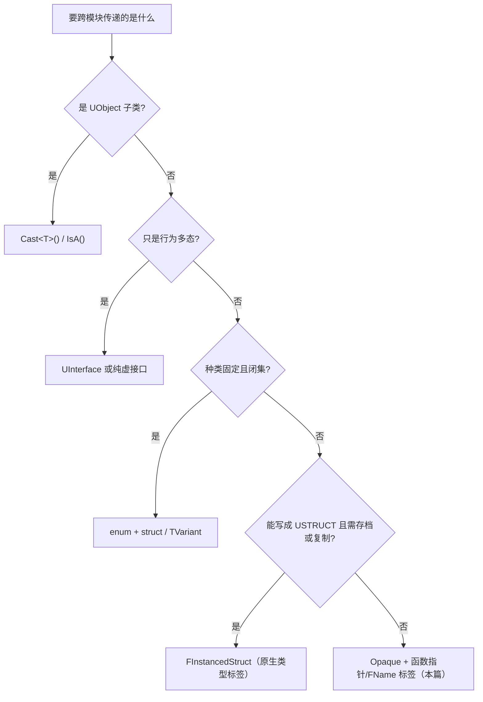
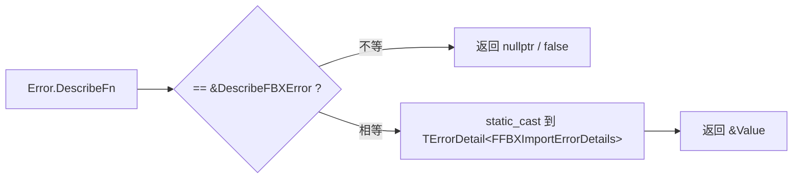

# 02 · UE 侧落地：别到处用 opaque，按对象类型选机制

## 0. 一句话结论

把 Hare 的 `opaque_` 搬进 UE 是**可行的，但只该用在第三种场景**：非 UObject 的、跨模块传递的、各插件专属的数据。UObject 有反射，请用 `Cast`；只是行为多态，请用 `UInterface`。

## 1. 三种机制的分工判据

| 机制 | 类型标签是什么 | 适用场景 | 不适用 |
|---|---|---|---|
| `Cast<T>()` / `IsA` | `UClass*`（反射） | 判断一个 `UObject` 是不是某具体类 | 非 UObject 数据；也不该用来做「同一操作的不同实现」 |
| `UInterface` | `UClass*` + `Implements<>()` | 不同类型对象提供同一操作（行为多态） | 不是为了「保存并恢复任意具体数据类型」设计的 |
| **Opaque + 类型标签** | 函数指针 / `UScriptStruct*` / `FName` | 非 UObject 的跨模块专属数据（错误细节、插件配置、驱动私有结构） | 需要蓝图/编辑器识别类型 → 应该用 `USTRUCT`/`UObject` 反射 |
| `enum class` + `struct` / `TVariant` | 枚举值 | 错误种类就固定那几种 | 种类由插件决定、核心模块不能预知 |
| `FInstancedStruct` | `const UScriptStruct*` | 细节能写成 `USTRUCT`，且需要存档/复制 | 细节含非 USTRUCT 类型，或不想要反射开销 |

流程图（一眼选路）：



## 2. 反例：公共模块被拖进依赖

三个导入模块各自失败原因不同：

```cpp
struct FFBXImportError   { int32 MeshIndex; FString MeshName; };
struct FGLTFImportError  { int32 NodeIndex; FString NodeName; };
struct FTextureImportError { int32 MipIndex; FString TextureName; };
```

如果公共资源模块想统一接收 `FImportError Error = Importer->Import(FilePath);`，最差的做法是让 `ResourceManager` 同时 include 三个 importer 的头 —— 于是**每加一个 importer，公共模块就要改头文件、重编译、重新做依赖评审**。这正是要避免的。

## 3. 实现：统一错误容器（放在公共模块）

```cpp
// ResourceCore/Public/ImportError.h
#pragma once

#include "CoreMinimal.h"

/** 细节对象公共基类：只为了让 TSharedPtr 能持有异构具体类型。 */
struct FErrorDetailBase
{
	virtual ~FErrorDetailBase() = default;
};

template <typename T>
struct TErrorDetail final : FErrorDetailBase
{
	T Value;

	explicit TErrorDetail(T InValue)
		: Value(MoveTemp(InValue))
	{
	}
};

/**
 * 跨插件统一错误。
 * 关键约定：DescribeFn 既负责「解释细节」，也充当「类型标签」——
 * 同一个 (T, DescribeFn) 组合必须一一对应，TryGet<T> 依赖这个不变量。
 */
struct FImportError
{
	using FDescribeFn = FString (*)(const FErrorDetailBase*);

	FName Domain;
	int32 Code = 0;
	FString Message;

	TSharedPtr<FErrorDetailBase> Detail;
	FDescribeFn DescribeFn = nullptr;

	FImportError() = default;

	template <typename T>
	static FImportError Make(
		FName InDomain,
		int32 InCode,
		FString InMessage,
		T InDetails,
		FDescribeFn InDescribeFn)
	{
		FImportError Result;
		Result.Domain = InDomain;
		Result.Code = InCode;
		Result.Message = MoveTemp(InMessage);
		Result.Detail = MakeShared<TErrorDetail<T>>(MoveTemp(InDetails));
		Result.DescribeFn = InDescribeFn;
		return Result;
	}

	bool IsValid() const
	{
		return Detail.IsValid() && DescribeFn != nullptr;
	}

	/** 通用路径：不需要知道任何具体类型。 */
	FString ToString() const
	{
		return IsValid() ? DescribeFn(Detail.Get()) : Message;
	}

	/** 专属路径：只有标签匹配才允许恢复具体类型。 */
	template <typename T>
	const T* TryGet(FDescribeFn ExpectedDescribeFn) const
	{
		if (!IsValid() || ExpectedDescribeFn == nullptr || DescribeFn != ExpectedDescribeFn)
		{
			return nullptr; // fail-closed：不匹配就返回空，绝不重解释
		}
		// 安全前提：DescribeFn 相等 ⟹ 该 Detail 一定由 TErrorDetail<T> 造出
		return &static_cast<const TErrorDetail<T>*>(Detail.Get())->Value;
	}
};
```

设计点逐条：

1. **为什么要有 `FErrorDetailBase`**：`TSharedPtr` 需要统一的持有类型，`TErrorDetail<A>` / `TErrorDetail<B>` 靠继承拿到共同基类。这是 `TSharedPtr` 的向上转换能力，**与 GC 无关**（不是 `UObject`，不参与 GC）。
2. **为什么用函数指针而不是虚函数**：虚函数能打印，但**不能当标签**（没有「这个 vtable 是不是那个模块的」这种廉价比较）。函数指针一次满足两件事：解释错误 + 反向识别来源。
3. **为什么堆分配**：UE 的错误细节常含 `FString` 等非平凡类型，Hare 的 24 字节内联存储装不下也不能直接 `memcpy`。错误路径不是热路径，一次 `MakeShared` 可以接受。
4. **`DescribeFn == nullptr` 也要挡住**：否则两个「没装 describe 的」错误会互相认亲。

## 4. 提供方：FBX 模块

```cpp
// FBXImporter/Public/FBXImportError.h
#pragma once

#include "ImportError.h"
#include "FBXImportError.generated.h" // 若细节要 UPROPERTY 存档才需要

struct FFBXImportErrorDetails
{
	int32 MeshIndex = INDEX_NONE;
	FString MeshName;
};

/** 必须导出（非 inline），否则跨模块取到的地址可能不唯一，见第 7 节坑 4。 */
MYFBXIMPORTER_API FString DescribeFBXError(const FErrorDetailBase* Data);

MYFBXIMPORTER_API FImportError MakeFBXImportError(int32 MeshIndex, const FString& MeshName);

/** 推荐：把「标签函数 + 类型转换」封装在声明它的模块里，调用方不必记函数指针。 */
MYFBXIMPORTER_API bool TryGetFBXImportError(const FImportError& Error, FFBXImportErrorDetails& OutDetails);
```

```cpp
// FBXImporter/Private/FBXImportError.cpp
#include "FBXImportError.h"

FString DescribeFBXError(const FErrorDetailBase* Data)
{
	const auto* Details = static_cast<const TErrorDetail<FFBXImportErrorDetails>*>(Data);
	return FString::Printf(
		TEXT("FBX 网格导入失败: %s (Index %d)"),
		*Details->Value.MeshName,
		Details->Value.MeshIndex);
}

FImportError MakeFBXImportError(int32 MeshIndex, const FString& MeshName)
{
	return FImportError::Make(
		TEXT("FBX"),
		1001,
		TEXT("FBX Import Failed"),
		FFBXImportErrorDetails{MeshIndex, MeshName},
		&DescribeFBXError);
}

bool TryGetFBXImportError(const FImportError& Error, FFBXImportErrorDetails& OutDetails)
{
	const FFBXImportErrorDetails* Details = Error.TryGet<FFBXImportErrorDetails>(&DescribeFBXError);
	if (Details == nullptr)
	{
		return false;
	}
	OutDetails = *Details;
	return true;
}
```

此时内部数据形态（和 Hare 的 `opaque_` 一一对应）：

```
FImportError
  ├─ Domain    = FBX
  ├─ Code      = 1001
  ├─ Message   = "FBX Import Failed"
  ├─ Detail ──▶ TErrorDetail<FFBXImportErrorDetails> { MeshIndex=3, MeshName="Body" }
  └─ DescribeFn = &DescribeFBXError        ← 类型标签
```

## 5. 消费方：两条路径，别混用

```cpp
// 路径 A：99% 的业务代码走这里，对具体类型一无所知
UE_LOG(LogResource, Error, TEXT("导入失败: %s"), *Error.ToString());

// 路径 B：只有确实需要专属字段时才恢复
FFBXImportErrorDetails Details;
if (TryGetFBXImportError(Error, Details))
{
	UE_LOG(LogResource, Error, TEXT("失败网格: %s (%d)"), *Details.MeshName, Details.MeshIndex);
}
```

路径 B 的判定过程：



只有第一个菱形成立，才允许发生那次 `static_cast`。这就是 Hare 里 `err.strerror != &opaque_strerror` 的等价物。

## 6. 和 UE 原生能力对照：什么时候其实不该自研

`Cast` / `UInterface` 不用多说。真正要比较的是 **`FInstancedStruct`**——它在 UE 5.8 已并入 `CoreUObject`（`Runtime/CoreUObject/Public/StructUtils/InstancedStruct.h`，早期版本在 StructUtils 插件里），本质就是「引擎自带的 opaque + 类型标签」：

| 能力 | `FInstancedStruct` | 本篇的函数指针方案 |
|---|---|---|
| 类型标签 | `GetScriptStruct()` 返回 `const UScriptStruct*`（`InstancedStruct.h:169`） | `DescribeFn` 函数指针地址 |
| 取回具体类型 | `GetPtr<T>()`，内部 `Struct->IsChildOf(TBaseStructure<T>::Get())`（`:192`、`:221`） | `TryGet<T>()`，比较标签后 `static_cast` |
| 存档 / 复制 | 白送：`Serialize`（`:156`）、`NetSerialize`（`:163`） | **不支持**，函数指针不能序列化 |
| 细节类型约束 | 必须是 `USTRUCT`（要反射） | 任意 C++ 类型 |
| 蓝图可见 | 是 | 否 |
| 额外开销 | 反射 + `UScriptStruct` 依赖 | 一次 `MakeShared` |

判据：

- 细节能写成 `USTRUCT`、且可能存档/联机 → **用 `FInstancedStruct`**，标签天生稳定（`UScriptStruct` 路径），坑 1、坑 2、坑 4 全部消失；
- 细节是纯 C++（模板类型、第三方库结构、不想拉反射依赖）、或错误只在当前进程内流转 → 用本篇方案；
- 只是想给错误分支 → 先考虑 `enum class`，别上类型擦除。

## 7. 四个必须注意的坑

### 坑 1：函数指针不是持久化 ID

函数指针只在当前进程、当前次构建里有效。**不能写进存档、配置、网络包、日志后据此复现**。

需要落盘时换稳定标识：

```cpp
// 和 DescribeFn 并存，判定优先用 TypeId（可序列化），DescribeFn 只管打印
FName TypeId = TEXT("FBX.ImportError");
```

### 坑 2：模块卸载后标签指向野函数

如果错误对象还活着，而提供 `DescribeFBXError` 的插件/模块已经卸载，函数指针就不可调用。

- 保证错误对象生命周期 **不超过** 所属模块；
- 跨帧持有错误时，转存 `Domain + Code + Message + TypeId`，或把细节序列化成 `FString`/`FInstancedStruct`。

### 坑 3：不要滥用类型恢复

如果业务代码必须知道 FBX、glTF、Texture 每个具体类型才能工作，说明统一接口已经失去意义。**大多数代码只该读 `Domain / Code / Message`**，只有确实要按专属字段分支的地方才 `TryGet`。

### 坑 4：跨模块静态链接会让地址不唯一

Windows 下如果 `DescribeFBXError` 是 `inline` / 静态库内容，被两个 DLL 各链一份，**两份地址不同 → `TryGet` 恒失败**（表现为「逻辑全对，就是拿不到细节」）。

- 标签函数必须**导出符号**（`MYMODULE_API`，非 `inline`、非匿名命名空间）；
- monolithic 构建下不会暴露这个 bug —— 典型的「打包版才炸」；
- 生产建议双标签：**判定用 `FName TypeId`，打印用 `DescribeFn`**，地址只作为进程内加速。

## 8. 放置与命名约定

| 东西 | 放哪 | 理由 |
|---|---|---|
| `FErrorDetailBase` / `TErrorDetail<T>` / `FImportError` | 公共模块 `Public/`（如 `ResourceCore`） | 生命周期 = 全进程；作用域 = 所有 importer |
| `FFBXImportErrorDetails` + `DescribeFBXError` + `Make/TryGet` | **FBX 模块** `Public/` | 所有者是 FBX；别的模块想知道 FBX 细节就必须显式依赖 FBX（依赖方向正确） |
| 具体 `Import()` 实现 | 各 importer `Private/` | 公共模块不可见 |

这条满足「新增插件不改核心」：新写一个 `MyCustomModelImporter`，自己定义 `FMyCustomImportError` + 自己的 `DescribeFn`，按 `FImportError::Make` 包装即可接入，`ResourceManager` **一行都不用改**。

## 9. 检查清单（落地前过一遍）

- [ ] 这个类型真的不是 `UObject`？是的话回去用 `Cast` / `UInterface`。
- [ ] 细节能不能写成 `USTRUCT` 且需要存档？能就换 `FInstancedStruct`。
- [ ] `DescribeFn` 是导出符号吗（不是 `inline`）？
- [ ] 有 `FName TypeId` 兜持久化吗？
- [ ] 有没有哪个调用方把 `TryGet` 当日常读字段用（说明抽象层次反了）？
- [ ] 错误对象有没有可能活过所属模块？
