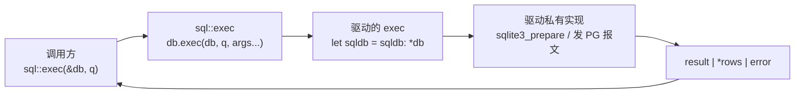
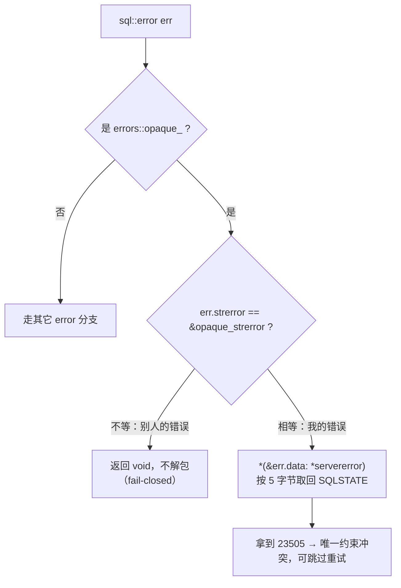

# 03 · 函数指针怎么「找到执行者」：vtable 的双向性，与地址当身份的边界

> 承接 [01](./01-hare-vtable-and-opaque.md)。01 讲的是「用函数指针当类型标签」；本篇只补一件事：**函数指针凭什么能担当执行者**，以及它凭什么能在事后认出自己。
> 出处同 01：[Writing SQL Drivers in Hare](https://blainsmith.com/articles/writing-sql-drivers-in-hare/)（Blain Smith，2026-11-02）。

## 0. 结论先行

1. 文章里函数指针同时干三件事，靠的是**同一个物理事实——它是一个地址**：调度（`exec`/`next`/`scan`）、解释（`strerror`）、身份（地址比较）。三者不是三个设计，是一个设计被用了三遍。
2. **谁把函数指针填进表里，谁就是执行者。** `db_vtable` / `rows_vtable` 由驱动填 → 驱动是执行者，接口**向下派发**；`value_vtable` 由调用方填 → 调用方是执行者，驱动只递一块 `*opaque`，这是**向上回调**。一个接口里同时存在向下与向上，才叫完整的类型擦除。
3. 「找到执行者」有两条路，不要混：**直接存指针**（分派，零查找）与**靠标签反查**（恢复，必须先证明）。
4. 地址能当身份，需要四个前提：进程内唯一、不被链接器折叠、模块还活着、存储够放。缺任何一条，症状都是「看起来匹配成功，实际读的是别人的内存」。

## 1. 三种角色，一个地址

| 角色 | 文章里的字段 | 怎么被触发 | 失效后果 |
|---|---|---|---|
| 调度（分派执行） | `db_vtable.exec` / `rows_vtable.next` | `sql::exec` 里一行转发 | 调不到驱动，接口变空壳 |
| 解释（打印） | `opaque_.strerror` | `sql::strerror(err)` 逐层下探到它 | 只能打印 `Message`，丢掉类型 |
| 身份（类型标签） | 同一个 `opaque_.strerror` | `err.strerror != &opaque_strerror` | 误读 24 字节（见第 3 节） |

分派之所以能"一步到位"，看这一行就够了：

```hare
export fn exec(db: *db, q: str, args: fmt::field...) (result | *rows | error | nomem) =
	db.exec(db, q, args...);
```

注意它把 `db` **自己**又当第一个参数传了回去。这是整个模式的枢纽：vtable 里只有函数、没有对象，所以**对象必须由调用方带回来**。C++ 里这一步被编译器塞在 `this` 里，Hare 里必须手写。UE 的 `UInterface` 也一样——`IInterface::Execute_Foo(Obj, ...)` 先拿 `Obj` 再取接口地址，本质是"你自己把对象递回去"。

## 2. 谁填表，谁是执行者

### 2.1 实现方填表 = 向下派发（db / rows）

```hare
const my_db_vtable: sql::db_vtable = sql::db_vtable {
	exec = &exec,
	close = &close,
};

export type db = struct {
	vtable: sql::db,   // 必须是第一个字段
	// ...
};
```

配套的两条硬约束：

- `vtable` **必须是第一个字段**。这样 `&my_db` 与 `my_db.vtable` 同址，`*my_db → *sql::db` 是零偏移，整个模块才敢依赖"拿到 `*sql::db` 就等于拿到 `*my_db`"。
- 每个实现函数**第一行先把自己转回来**：`let sqldb = sqldb: *db;`。这是一次无检查的向下转型，安全性完全由"布局不变"这条纪律担保——和 C++ 里 `static_cast<Derived*>` 同一档信任级别。



### 2.2 调用方填表 = 向上回调（Custom Scan Destinations）

这一节是文章里最容易被略过、但最能说明"执行者"含义的地方。`sql::value` 也是一张 vtable，可它由**使用方**填：

```hare
type coord = struct {
	vtable: sql::value,   // 同样首字段
	lat: f64,
	lon: f64,
};

const coord_vtable: sql::value_vtable = sql::value_vtable {
	scan = &coord_scan,
};

fn coord_scan(v: *sql::value, data: *opaque) (void | sql::error) = {
	let v = v: *coord;
	const s = strings::trim(postgresql::text(data), '(', ')');
	// ...
};
```

扫描时驱动并不知道 `coord` 存在，它只负责把"这一列的原始数据"递过来：

- 驱动侧：`data` 指向什么，**由驱动自己定义**（SQLite 递一种，PostgreSQL 递另一种）；
- 调用方侧：`coord_scan` 知道 `data` 该被谁解释（`postgresql::text`），于是自己解；
- 接口侧：只承诺"有个函数指针 + 一块不透明数据"，**不承诺数据长什么样**。

于是同一个接口里出现了两个方向的调用：

| | `db_vtable` / `rows_vtable` | `value_vtable` |
|---|---|---|
| 表结构谁定义 | 公共模块 `sql` | 公共模块 `sql` |
| 函数指针谁填 | **驱动** | **调用方**（每个目标类型） |
| 调用方向 | 公共 → 驱动（向下派发） | 驱动 → 调用方（向上回调） |
| 回调收到的上下文 | 驱动自己的 `*db` | `*opaque data`（含义由驱动定义） |
| 典型误用 | 在 `vtable` 前面塞字段（布局崩） | 把 `data` 当成已知结构直接读（跨驱动崩） |

**判据**：接口只能削掉"调用方知道是什么"的那部分信息，削不掉"必须有人知道"的那部分。`db` 的细节驱动知道 → 接口不碰；列数据的编码调用方知道 → 接口不碰。**接口的价值不在于消灭知识，而在于把知识放回它该在的那一侧。**

### 2.3 顺带一个已验证的代价

`value_vtable` 方案意味着**每个自定义目标类型多一个静态表 + 一次间接调用**。文章里这是划算的，因为扫描是逐行热路径、表是编译期常量。放到 UE 里要小心：如果是每帧给几百个控件做绑定，优先 `TFunctionRef` 栈上回调，而不是再发明一张 vtable。

## 3. 「找执行者」的两种查法

### 3.1 直接存指针：分派不需要查找

调用点是一行 `db.exec(db, ...)`：无 `switch`、无哈希、无字符串比较。代价是**每个实例多一个指针**——Hare 把它压进首字段，实际不多占空间，因为驱动本来也要在结构里存 `sqlite3*`。这是"零成本抽象"在 C 语境下的标准形态。

### 3.2 靠标签反查：恢复必须先证明

`opaque_` 的 `strerror` 同时是标签，于是解包长这样：

```hare
export fn unwraperror(err: errors::opaque_) (servererror | void) = {
	if (err.strerror != &opaque_strerror) {
		return;
	};
	return *(&err.data: *servererror);
};
```

文章原话是这套方案唯一的保险说明：

> A mismatched pointer means the error came from another module, and `unwraperror` returns void instead of reinterpreting 24 bytes as the wrong type. **Nothing else prevents that misread, so keep the check if you write your own unwrap function.**

换句话说：**语言和内存模型都不保护你，只有这个 `if`。** 失败分支必须画出来，不能只在正文里嘴硬：



### 3.3 判据：分派 vs 恢复

| 你的处境 | 该用的手法 | 原因 |
|---|---|---|
| 我知道"这一步该由谁执行" | 直接存函数指针（vtable） | 分派不需要证明，调用点越直越好 |
| 我收到一个东西，**不知道**它是谁做的 | 标签 + 反查 | 恢复必须先把"是不是你的"证出来 |
| 我既想统一处理，又想偶尔拿细节 | 两层：统一层只读 `Domain/Code/Message`，专属层 `TryGet` | 见 01 第 5 节、02 第 5 节 |

**最常见的架构错误**：把"恢复"当成"分派"来做——即业务代码普遍 `TryGet` 一通再 `if/else`。那是把类型标签降级成了手写 `switch`，抽象已经失去意义（02 坑 3）。

## 4. 地址当身份的四个前提

| 前提 | 不满足时的症状 | 怎么查/怎么防 |
|---|---|---|
| 进程内唯一 | 逻辑全对但 `TryGet` 恒失败（静态库被两个模块各链一份） | 标签函数必须导出（`MODULE_API`），不能 `inline`/匿名命名空间 |
| 不被链接器折叠 | **两个不同模块的标签函数地址相同 → 认亲，读到别人的数据** | 见下方 4.1 |
| 模块还活着 | 错误对象跨帧活过插件卸载 → 调野函数 | 生命周期 ≤ 所属模块；跨帧转存 `TypeId` |
| 存储够放 | 写入越界 / 读出截断 | `static_assert(size(T) <= size(opaque_data))` |

### 4.1 链接器的相同代码折叠（ICF）

这是这套方案在 C++ / UE 里**唯一会静默错判**的坑，文章没提，因为 Hare 的实现方式让它不容易触发：

- 同一份**函数体完全相同**的函数，在链接期可能被合并成一个地址：MSVC 侧是 `/OPT:ICF`，LLVM/GNU 工具链侧是 `--icf=all`，编译器侧是 `-fmerge-functions`。
- 两个模块各写一个 `FString DescribeFBXError(...)` 和 `FString DescribeGLTFError(...)`，如果函数体恰好逐字相同（比如都只是 `return Data ? TEXT("") : TEXT("");` 这种占位实现），折叠后地址相同 → **标签比较成立 → 解包成错误类型 → 读到垃圾**。
- 导出符号（`__declspec(dllexport)`）通常不会被跨 DLL 折叠，但**同一个 DLL 内部仍可能被合并**。

规避（按代价从低到高）：

1. 标签函数体不要写成纯占位/纯转调，让它对 `Data` 做一次真实解引用（例如 `check(Data != nullptr);` 之后再读字段），折叠概率大幅下降；
2. 只把地址当**进程内加速**，真正的判定项用 `FName TypeId`（可序列化、不受链接器影响），两者都成立才解包；
3. 干脆走 `FInstancedStruct`，标签换 `const UScriptStruct*`（见 02 第 6 节），这类坑一次性消失。

> 未核实：ICF 在上述具体开关组合下对 UE 打包产物的实际影响没有实测过（本仓不给无法验证的断言）。上面的定性结论来自链接器文档与 `-fmerge-functions` 的语义，落地前建议至少在 Release 产物里打印一次两个标签的地址做对照。

## 5. 接口契约：作者自己踩过的三件事

文章结尾那段"I got two things wrong at first"是全篇最有价值的部分，因为它讲的是**接口签名看不出来的东西**：

1. **写出来的字符串是借用还是拷贝，必须在文档里写死。**
   Hare 里 `name` / `country` 借用驱动的读缓冲，只在下一次 `sql::next` 之前有效。签名 `scan(rows, &name)` 完全看不出来这件事。→ 任何"通过指针/引用往外递东西"的接口，都要对**有效期**负责，UE 里就是 `FStringView` vs `FString` 的选择，选完要写在头文件注释上。
2. **让目标类型决定解析，而不是列类型。**
   文章原话：`let the destination type choose the parse instead of the column type, because the destination records what the caller asked for`。→ 目标是 `FString` 就把列按文本解析，目标是 `double` 就按数值解析；不要因为列在数据库里声明成 `TEXT` 就拒绝转成数值。UE 对应：`FJsonObjectConverter` 按 `UStruct` 字段类型反序列化，而不是按 JSON 值的原始类型。
3. **谁创建，谁销毁，要写在接口上。**
   `exec` 返回 `*sql::rows`，所以 rows 必须堆分配、由 `finish` 释放。函数名 `finish` 而不是 `close`，就是在暗示"这次结果集结束，不是连接结束"。→ UE 里对应 `TSharedPtr` / `TUniquePtr` 的所有权声明，以及"返回裸指针时用谁释放"的注释。

## 6. 落回 UE 的对照（只列差异，机制见 02）

| Hare 的做法 | UE 里对应的东西 | 差异与注意 |
|---|---|---|
| 手写 `vtable` + 首字段同址 | C++ 虚表（编译器自动排在地址 0） | `UObject` **不要**再自己搞首字段；`Cast<>` 走反射而不是地址断言 |
| 实现函数内 `let d = d: *db` | `static_cast<Derived*>(this)` | 同一档信任；UE 里要过 `check()` 就别用裸 `static_cast` |
| 调用方填 `value_vtable` | `TFunction` / `TFunctionRef` / delegate | UE 侧优先带上下文的回调，别为了"对称"再造裸函数指针表 |
| `*opaque data` | `void*` + `Size` + 编码约定 | 跨插件传裸内存必须三件一起传，否则就是 UB 温床 |
| 地址当标签 | `FName TypeId` / `UScriptStruct*` / 导出 describe 函数 | 见 02 第 7 节四坑 |

## 7. 一句话收尾

函数指针能"找到执行者"，不是因为它聪明，而是因为**它是一个地址**：地址可以被调用（分派），也可以被比较（身份）。
一旦这个地址变得不唯一（静态链接、ICF）或会消失（模块卸载），两种能力就同时失效。
所以标签要绑在比"这一次运行"更稳的东西上——只要它需要跨出进程边界。
