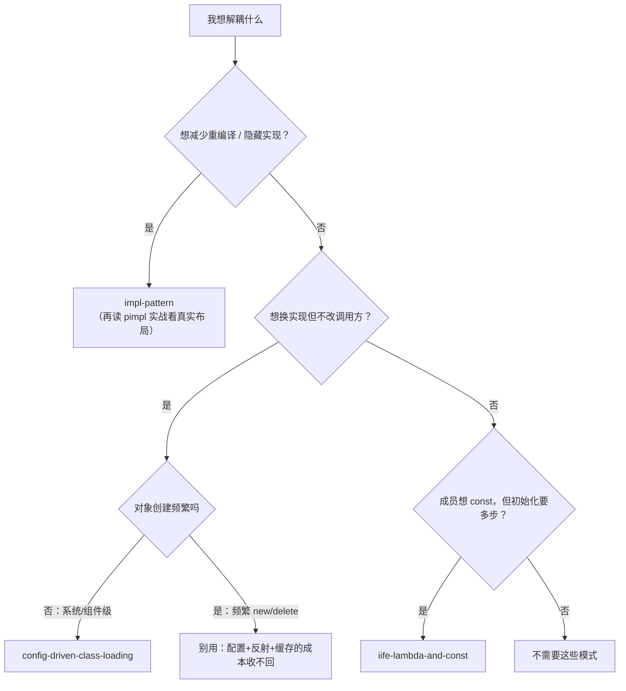

# 架构：编译防火墙、配置驱动、const 纯洁性

这一类解决的是同一个问题的三个切面：**让"要改的东西"尽量少地波及"不该改的东西"**——改实现不惊动调用方（Impl/Pimpl）、改种类不惊动核心（配置驱动）、改逻辑不惊动接口契约（const）。

## 结论先行

1. **砍编译依赖** → `impl-pattern.md`；**想知道引擎自己怎么用它** → `pimpl-replicationsystem.md`（同一个模式，前者讲规范，后者讲源码里真实的成员布局与构造流程）。
2. **"换一个实现但不改调用方代码"** 的标准解法是 *配置 + 反射 + 熔断*，见 `config-driven-class-loading.md`。它的成立前提是**对象创建不频繁**（系统/组件层），反复 new/delete 的对象用它是负收益。
3. **成员要 `const`、初始化又需要多步逻辑**时，`iife-lambda-and-const.md` 给的是"用 IIFE lambda 在初始化列表里算完再写回"的写法；它换来的安全性与可读性是真的，但**调试栈变深**也是真的。

## 文件

| 文件 | 原文文件名 | 讲什么 |
|---|---|---|
| [impl-pattern.md](./impl-pattern.md) | `UE_C++架构指南_Impl模式.md` | 编译防火墙 / 隐藏实现 / ABI 稳定三个动机；什么时候该用；UE5 里头文件当门面、cpp 当车间的写法 |
| [pimpl-replicationsystem.md](./pimpl-replicationsystem.md) | `UE_C++架构指南_Pimpl实战_ReplicationSystem解析.md` | 逐项解析 `FReplicationSystemImpl` 的成员分类（借用指针/值类型子系统/句柄/帧状态）、Params 集中化构造、`TPimplPtr`/`MakePimpl`、Init/Deinit 对称性、决策清单 |
| [config-driven-class-loading.md](./config-driven-class-loading.md) | `UE_C++架构指南_配置驱动类加载与FailFast机制.md` | INI 驱动 + 反射解析 + 前置熔断 + 类级缓存 + 职责分离五件套；以 `UNetDriver` 创建 ReplicationBridge 为实例；附最小判定准则与源码位置 |
| [iife-lambda-and-const.md](./iife-lambda-and-const.md) | `C++架构指南_IIFE_Lambda与Const安全性.md` | 用立即执行 lambda 在成员初始化时完成多步计算，保住 `const`；作用域隔离与意图高亮；零成本解释；什么时候**不要**用 |

## 怎么选

> 这三篇的共同暗线：**接口的稳定性靠"延迟决定"换来**。Impl 延迟到 cpp 才决定成员；配置驱动延迟到运行期才决定类型；IIFE 延迟到初始化完成才交出 `const` 对象。延迟都有代价，别在热路径上延迟。
