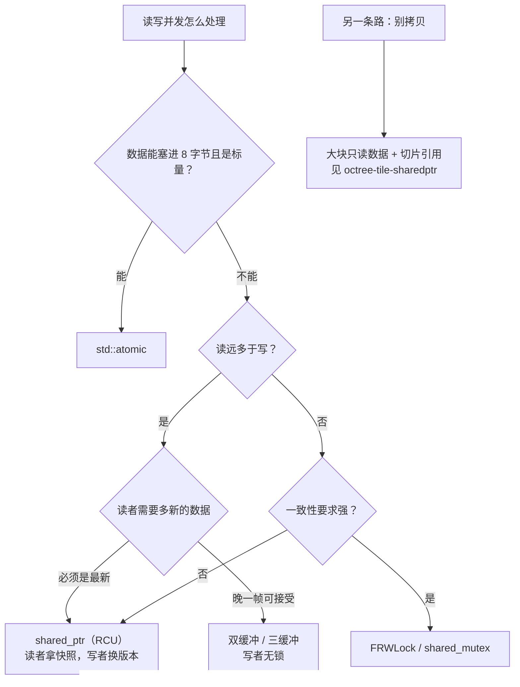

# 并发：读写分离、RCU、双缓冲、共享切片

这一类只回答一个问题：**读线程和写线程同时碰同一份数据时，怎么既不撕裂、又不把读者拖进锁里。**

## 结论先行

1. **撕裂的根源是"读者拿到的不是一份完整的快照"**：`int`/指针在 x64 上是单条指令，不撕裂但仍是 data race；8~16 字节要两条 mov，会读到"前旧后新"；更大的结构必然 memcpy，撕裂是常态。
2. 按"写者频率 / 一致性强度"选机制：

| 机制 | 适用 | 代价 |
|---|---|---|
| `std::atomic` | ≤ 8 字节的标量 | 只有标量；复合类型不适用 |
| `shared_ptr<const T>`（用户态 RCU） | 读极多、写极少，读者要能拿稳一份快照 | 每次读一次原子引用计数；写者分配新版本 |
| 双缓冲 / 三缓冲 | 写者完全无锁（单写者模型） | 读者可能看到上一帧的数据（最终一致） |
| `FRWLock` / `shared_mutex` | 需要强一致、写者也不少 | 读者也会被阻塞/抖动 |

3. **"共享而不是拷贝"是另一条正交的解法**：把大块只读数据放进 `TSharedPtr`/`TSharedRef`，切片只持有引用（写时拷贝）。`octree-tile-sharedptr.md` 是引擎里真实的范本。

## 文件

| 文件 | 原文文件名 | 讲什么 |
|---|---|---|
| [rcu-and-double-buffering.md](./rcu-and-double-buffering.md) | `C++线程安全读写分离_RCU与双缓冲模式.md` | 撕裂的三种规模；`atomic` / `shared_ptr<const T>` 用户态 RCU / 双缓冲与三缓冲 / `FRWLock` 四个方案的可编译实现与内存模型；UE 里对应的 Double Buffer、`FSharedBuffer`、显式 `FRWLock`；选型决策流；C++20 替代（`atomic<shared_ptr>`） |
| [octree-tile-sharedptr.md](./octree-tile-sharedptr.md) | `UE_Octree_Tile切片与SharedPtr数据共享模式.md` | `FNavigationOctree` + `FRecastTileGenerator`：全局八叉树存一份，Tile 生成时只切片引用；数据库 View / COW / Tile-Based 世界分区三个思想来源；内存效率、构建性能、线程安全、增量更新、数据去重五点收益；适用条件 |

## 怎么选

> 两篇的共同点：**不要试图让"同一份可变数据"同时被多方安全访问，而是让"访问的那一方"持有一份不可变的东西**——要么是不可变快照（RCU/双缓冲），要么是共享所有权的只读视图（SharedPtr 切片）。
